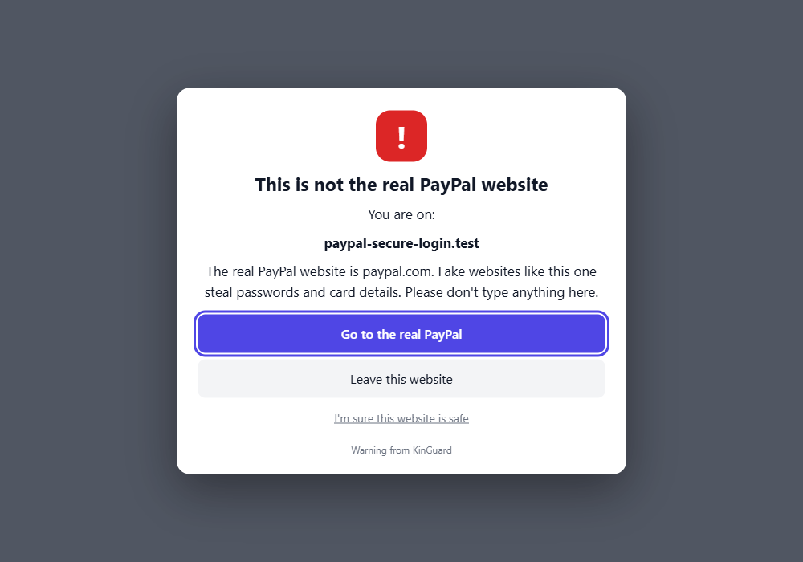
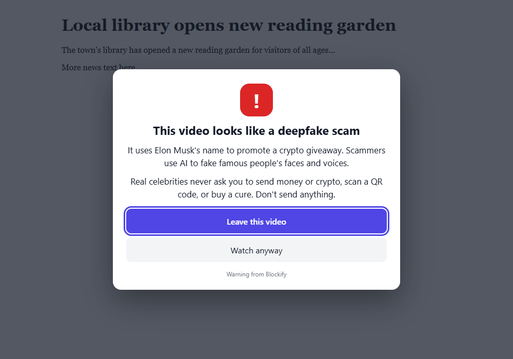

# Blockify

**A free browser extension that blocks ads and protects you from online scams.**

Made for people who just want the internet to be safe and calm, like your parents or grandparents. Install it once and it works on its own.

Works in **Chrome, Edge, Brave, Opera** and **Firefox**.

---

## What it does

**Blocks ads, trackers and popups**: including YouTube ads and cookie banners.

**Stops scams before they happen**
- Warns you on **fake websites** pretending to be PayPal, your bank or Amazon
- Warns if you type your **bank or email password on the wrong site**
- Blocks fake **"I'm not a robot – press Windows + R"** tricks that install viruses
- Flags pages asking for **gift cards, Bitcoin, remote access or "support" calls**
- Shows a clear warning before opening **known malware and phishing sites**
- Stops fake **"Your PC is infected"** screens, alert loops and notification spam

**Spots AI fakes and checks facts**
- Shows YouTube's hidden **"altered or synthetic content"** label clearly, so you know when a video is AI-made
- Warns about **deepfake scam videos**: fake celebrities promoting crypto giveaways, "investment platforms" or miracle cures
- **Check facts** in one click: right-click any text, use the button under YouTube videos, or open the toolbar popup. Google, fact-checkers or ChatGPT open in a new tab.

**Learns as you browse**: it spots ads no list knows about (the "Ad" and "Sponsored" labels, standard banner sizes), remembers them, and blocks an ad company everywhere once it has seen it on 3 different sites.

**Private**: no accounts, no tracking. Everything stays on your computer.

---

## Screenshots

<table>
<tr>
<td width="50%"><br><sub><b>Fake website</b>: you're told where the real site is.</sub></td>
<td width="50%"><br><sub><b>Dangerous site</b>: stopped before it loads.</sub></td>
</tr>
<tr>
<td><br><sub><b>Deepfake scam video</b>: the video is paused before you send anything.</sub></td>
<td valign="top"><br><sub><b>Check facts</b>: one click under any YouTube video.</sub></td>
</tr>
<tr>
<td><br><sub><b>Settings → Protection</b>: switch each protection on or off.</sub></td>
<td><br><sub><b>Settings → Filters</b>: choose what to block.</sub></td>
</tr>
<tr>
<td colspan="2" align="center"><br><sub><b>Settings → Smart</b>: see what Blockify has learned, and undo anything.</sub></td>
</tr>
</table>

---

## Install

1. Download the latest zip from **[Releases](../../releases/latest)** (`blockify-chrome` for Chrome/Edge/Brave/Opera, `blockify-firefox` for Firefox) and unzip it.
2. **Chrome / Edge:** open `chrome://extensions`, turn on **Developer mode**, click **Load unpacked**, and pick the unzipped folder.
   **Firefox:** open `about:debugging#/runtime/this-firefox`, click **Load Temporary Add-on**, and pick `manifest.json`.
3. Pin the Blockify icon to the toolbar. Done.

> **Tip:** also turn on your browser's own protection: **Chrome → Settings → Privacy and security → Security → Enhanced protection**. It works alongside Blockify.

## Using it

- **Something annoying still showing?** Click the icon, then **Hide an ad on this page**, then click it.
- **A site doesn't work properly?** Click the icon and switch off **This site**.
- **Never want to see a site again?** Click the icon, then **Block site**.
- **Got a warning but the site is fine?** Click **"I'm sure this website is safe"**.

---

## For developers

```bash
npm run filters    # download & compile filter lists into rules/
npm run check      # validate rules and files
npm install && npm run test:e2e   # 69 end-to-end checks in real Chrome
npm run build      # store-ready zips in dist/
```

- **Filter lists:** EasyList, EasyPrivacy, uBlock filters, Peter Lowe, URLhaus, phishing and cookie lists, compiled into native browser rules. Supports uBlock/ABP syntax, including scriptlets and `:has-text()`-style rules.
- **Releases:** every version bump on `main` publishes a GitHub Release automatically. Filter lists also refresh every Monday and ship as a new release.
- **Code:** `src/background.js` (rules & learning), `src/content/` (page protections, smart detection, scam guard), `src/options` and `src/popup` (UI), `scripts/` (build tools), `tests/` (e2e suite and [`playground.html`](tests/playground.html)).

[Privacy policy](PRIVACY.md) · Blockify is a safety layer, **not antivirus**: keep Windows Security on.
