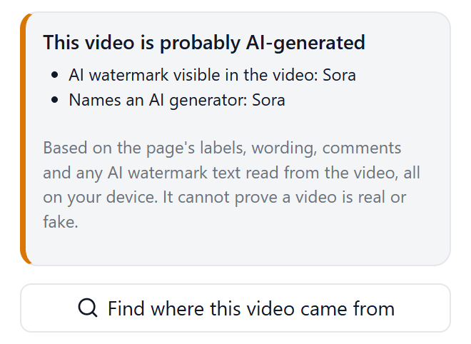
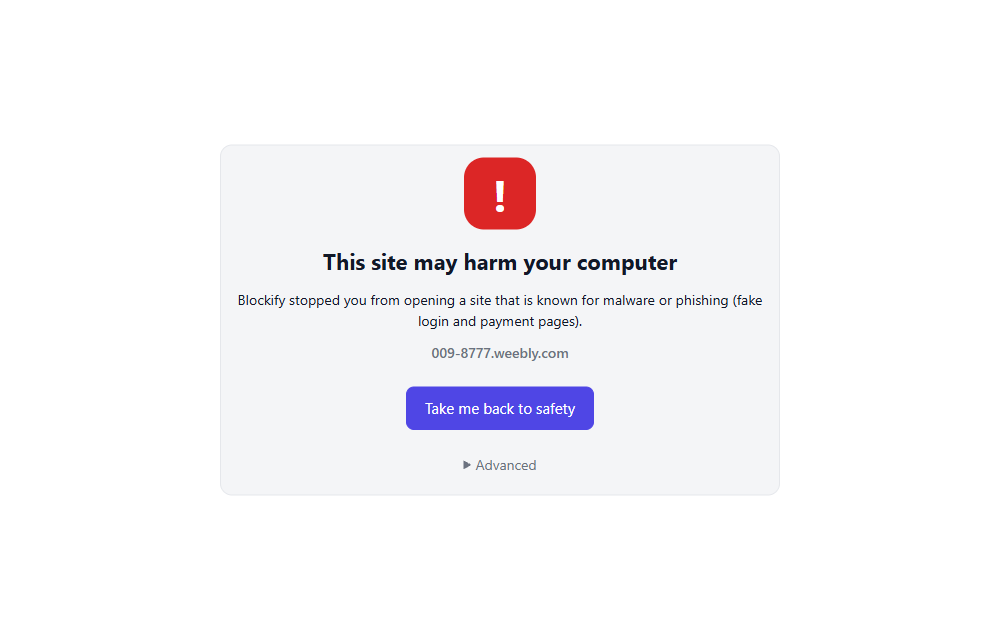
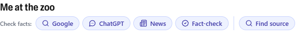
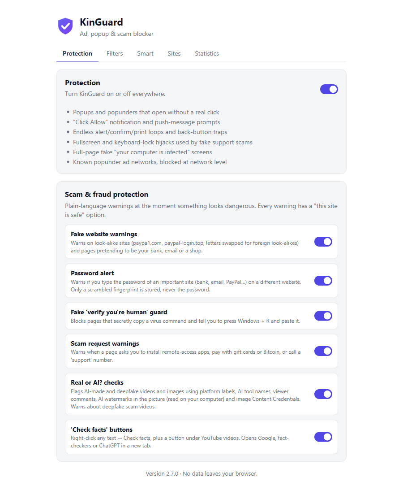

<div align="center">

# KinGuard

### Is it real or AI? Is it a scam? KinGuard tells you.

A free browser extension that spots AI-made and deepfake videos, warns you about fake websites and scams, and blocks ads. Made for people who just want the internet to be safe and calm, like your parents or grandparents. Install it once and it works on its own.

[](https://github.com/r00tmebaby/KinGuard/actions/workflows/release.yml)
[](https://github.com/r00tmebaby/KinGuard/actions/workflows/release.yml)
[](https://github.com/r00tmebaby/KinGuard/releases/latest)
[](https://github.com/r00tmebaby/KinGuard/releases)
[](LICENSE)
[](CHANGELOG.md)
[](https://github.com/r00tmebaby/KinGuard/stargazers)


**[Download](https://github.com/r00tmebaby/KinGuard/releases/latest)** · **[Video](https://youtu.be/jZSbmQ35CPc)** · **[Screenshots](#screenshots)** · **[Install](#install)** · **[Privacy](PRIVACY.md)** · **[Changelog](CHANGELOG.md)**

<a href="https://youtu.be/jZSbmQ35CPc" title="Watch the KinGuard video on YouTube">
  
</a>

<sub>Watch the 15-second video on YouTube</sub>

</div>

---

## Is it real or AI?

Today most people can't tell what's real, what's fake and what's made by AI. KinGuard checks for you, **for free, on your own computer**:



- **AI watermarks in the picture:** reads the corners of the video you're watching for AI generator watermarks (Sora, Veo, Kling, Hailuo, Meta AI, Gemini…). The text recognition runs inside your browser; nothing is uploaded.
- **Platform AI labels:** shows the "AI-generated" labels that YouTube, TikTok and Meta often hide.
- **What the video says about itself:** AI tool names (Sora, Veo, Seedance, Runway…), "made with AI" wording and AI hashtags.
- **What viewers say:** when many commenters say a video is AI or fake, you'll know.
- **Image Content Credentials:** right-click any image and choose *Is this image real or AI?* to read the tamper-proof "made with AI" record that OpenAI, Adobe, Google and others embed.
- **Where did this come from?** One click sends the video frame or image to Google Lens, to find the original, the creator, or a fact-check.
- **Deepfake scam warnings:** fake celebrities promoting crypto giveaways, "investment platforms" or miracle cures are paused before you send anything.

On YouTube a chip under the video says *Likely AI-generated*, *AI-generated (labelled)* or *Possible deepfake scam*, with the reasons. On any other site, open the KinGuard icon for the **AI check**.

<sub>These checks find the signs that AI content leaves behind. They can't prove a video is real: an AI video with no label, no watermark and no clues can still slip through, and no tool can be certain from the pixels alone.</sub>

<br clear="right">

## What else it does

**Blocks ads, trackers and popups**: including YouTube ads, cookie banners and "Subscribe now / special offer / No thanks" boxes, which are closed for you automatically.

**Stops scams before they happen**
- Warns you on **fake websites** pretending to be PayPal, your bank or Amazon
- Warns if you type your **bank or email password on the wrong site**
- Blocks fake **"I'm not a robot – press Windows + R"** tricks that install viruses
- Flags pages asking for **gift cards, Bitcoin, remote access or "support" calls**
- Shows a clear warning before opening **known malware and phishing sites**
- Stops fake **"Your PC is infected"** screens, alert loops and notification spam

**Checks facts**
- **Check facts** in one click: right-click any text, use the buttons under YouTube videos, or open the toolbar popup. Choose **Other news sources** (is anyone else reporting it?), **Fact-checkers** (claims already reviewed by professionals), **ChatGPT** or **Google**, each opening in a new tab. Brand-new stories usually have no fact-check yet, so for news, "other sources" is the best first check.

**Learns as you browse**: it spots ads no list knows about (the "Ad" and "Sponsored" labels, standard banner sizes), remembers them, and blocks an ad company everywhere once it has seen it on 3 different sites.

**Private**: no accounts, no tracking. Everything stays on your computer.

---

## Screenshots

<table>
<tr>
<td width="50%" valign="top"><br><sub><b>Real or AI?</b>: AI watermark found in the video, with a one-click source search.</sub></td>
<td width="50%"><br><sub><b>Deepfake scam video</b>: the video is paused before you send anything.</sub></td>
</tr>
<tr>
<td width="50%"><br><sub><b>Fake website</b>: you're told where the real site is.</sub></td>
<td width="50%"><br><sub><b>Dangerous site</b>: stopped before it loads.</sub></td>
</tr>
<tr>
<td colspan="2" align="center"><br><sub><b>Check facts</b>: one click under any YouTube video.</sub></td>
</tr>
<tr>
<td><br><sub><b>Settings → Protection</b>: switch each protection on or off.</sub></td>
<td><br><sub><b>Settings → Filters</b>: choose what to block.</sub></td>
</tr>
<tr>
<td colspan="2" align="center"><br><sub><b>Settings → Smart</b>: see what KinGuard has learned, and undo anything.</sub></td>
</tr>
</table>

---

## Install

1. Download the latest zip from **[Releases](../../releases/latest)** (`kinguard-chrome` for Chrome/Edge/Brave/Opera, `kinguard-firefox` for Firefox) and unzip it.
2. **Chrome / Edge:** open `chrome://extensions`, turn on **Developer mode**, click **Load unpacked**, and pick the unzipped folder.
   **Firefox:** open `about:debugging#/runtime/this-firefox`, click **Load Temporary Add-on**, and pick `manifest.json`.
3. Pin the KinGuard icon to the toolbar. Done.

> **Tip:** also turn on your browser's own protection: **Chrome → Settings → Privacy and security → Security → Enhanced protection**. It works alongside KinGuard.

## Using it

- **Something annoying still showing?** Click the icon, then **Hide an ad on this page**, then click it.
- **A site doesn't work properly?** Click the icon and switch off **This site**.
- **Never want to see a site again?** Click the icon, then **Block site**.
- **Got a warning but the site is fine?** Click **"I'm sure this website is safe"**.

---

## For developers

```bash
npm run filters    # download & compile filter lists into rules/
npm run check      # validate rules and files
npm install && npm run test:e2e   # 69 end-to-end checks in real Chrome
npm run build      # store-ready zips in dist/
```

- **Filter lists:** EasyList, EasyPrivacy, uBlock filters, Peter Lowe, URLhaus, phishing and cookie lists, compiled into native browser rules. Supports uBlock/ABP syntax, including scriptlets and `:has-text()`-style rules.
- **Releases:** every version bump on `main` publishes a GitHub Release automatically. Filter lists also refresh every Monday and ship as a new release.
- **Code:** `src/background.js` (rules & learning), `src/content/` (page protections, smart detection, scam guard), `src/options` and `src/popup` (UI), `scripts/` (build tools), `tests/` (e2e suite and [`playground.html`](tests/playground.html)).

[Privacy policy](PRIVACY.md) · KinGuard is a safety layer, **not antivirus**: keep Windows Security on.
